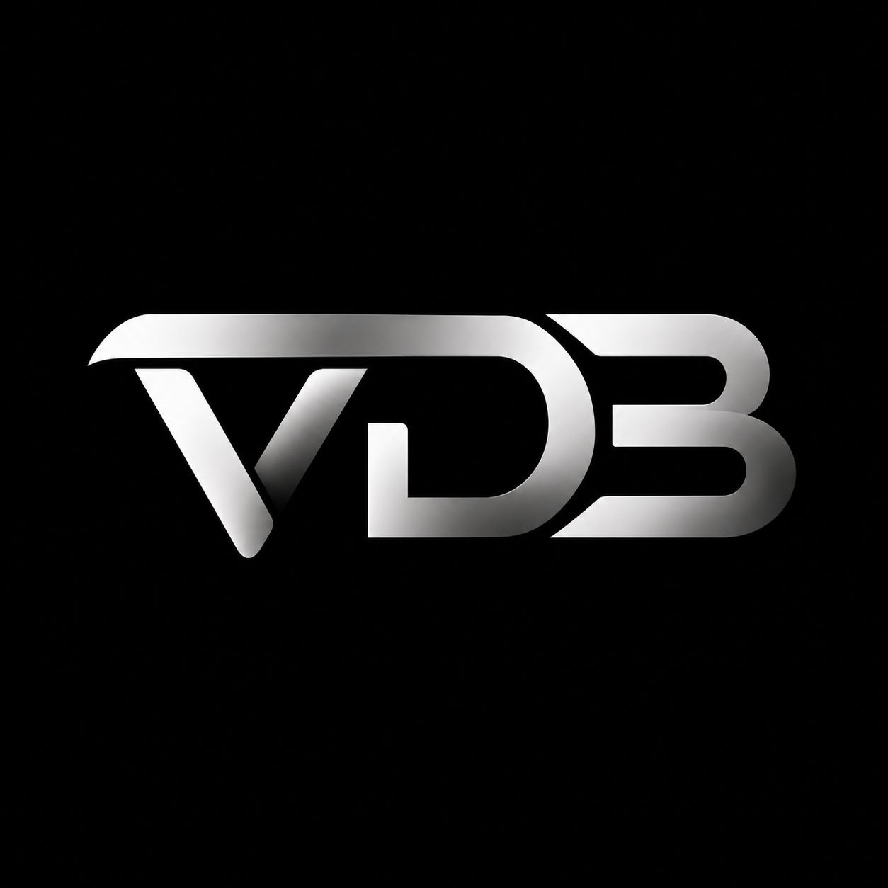

<p align="center">
  
</p>

# vdb

*vdb is a financial data engine built on exact arithmetic, explicit schemas, and transfers that
cannot half-happen.*

> **Status: pre-alpha.** The in-memory core works and is tested. There is no storage engine, no
> durability, no replication, and no stable public API. Do not use vdb to hold real money yet.

## Why

Financial software fails in boring ways. A float rounds the wrong way. An unchecked add wraps. A
transfer debits one account and forgets the other. vdb is an attempt to make those failures
impossible to express.

The core is small on purpose. A table maps a `u64` key to a typed schema. A schema is a fixed set of
named, typed fields. The operation API has two verbs: checked arithmetic on one field, and an atomic
transfer between two ledger-bound schemas. Direct field writes go through `set_value`, which is
closed for ledger-bound schemas.

No dependencies. No `unsafe`. No hidden I/O. Just the Rust standard library and a handful of
invariants.

## Documentation

There are no external docs yet. The source is the specification:

* [`src/engine/types.rs`](src/engine/types.rs) — `Value`, `ValueType`, `Schema`, `Table`, `apply`.
* [`src/engine/operations.rs`](src/engine/operations.rs) — arithmetic and transfer semantics.
* [`src/engine/error_types.rs`](src/engine/error_types.rs) — the typed error model.
* [`src/engine/parser.rs`](src/engine/parser.rs) — string-to-value parsing and zero initialization.
* [`src/engine/parser_name.rs`](src/engine/parser_name.rs) — field-name validation.
* [`src/engine/parser_ledger.rs`](src/engine/parser_ledger.rs) — ledger-id validation.
* [`src/tests/`](src/tests) — executable specification.

## Start

```console
$ git clone https://github.com/angryduck1/vdb.git
$ cd vdb
$ cargo test
```

vdb currently builds as a binary crate. `src/main.rs` is empty: there is no CLI or server yet. The
tests are the interface. A stable Rust toolchain with edition 2024 support is required.

## The architecture

A `Table` is a `HashMap<u64, Schema>`. A `Schema` owns a fixed array of values, the matching field
names, an initialization policy, and an optional ledger id.

```rust
pub enum Value {
    Int(i128),
    UInt(u128),
    Float(f64),
    Bool(bool),
    String(String),
    VectorInt(Vec<i128>),
    VectorFloat(Vec<f64>),
}
```

### Values

| Type | Rust representation | Intended use |
| --- | --- | --- |
| `Int` | `i128` | Exact signed balances, in integer minor units. |
| `UInt` | `u128` | Exact unsigned amounts, in integer minor units. |
| `Float` | `f64` | Non-monetary numeric data. Transfers reject it. |
| `Bool` | `bool` | Flags and state. |
| `String` | `String` | Metadata, identifiers, descriptions. |
| `VectorInt` | `Vec<i128>` | Exact integer vectors. |
| `VectorFloat` | `Vec<f64>` | Embeddings, features, ML metadata. |

### Operations

| Operation | Target | Rules |
| --- | --- | --- |
| `Arith { Add, Sub, Mul }` | One field | The target must not be ledger-bound. Target and amount must share a type. `Int`, `UInt`, and `Float` are supported. All integer arithmetic is checked. |
| `Arith { Div }` | One field | `Float` only. Division by zero returns `DivideByZero`. |
| `Transfer { from, to, amount }` | Two fields | The schemas must differ. Both must be ledger-bound to the same ledger. Both balances must be `Int`; the amount must be `UInt`. Both sides are checked before either is written. |

A ledger-bound schema is immutable through `set_value` and `Arith`. Value moves only through
`Transfer`, and a failed transfer leaves the table unchanged.

## Example

The engine is not exported as a library yet. This is the current internal API, abridged and with
error handling unwrapped:

```rust
use std::collections::HashMap;
use std::num::NonZeroU32;

use crate::engine::operations::{FieldRef, Operation};
use crate::engine::types::{Policy, Table, Value};

let mut table = Table { map: HashMap::new() };

table.add_values(
    1,
    vec![Value::Int(100)],
    vec!["balance"],
    Policy::Inline,
    NonZeroU32::new(700),
).unwrap();

table.add_values(
    2,
    vec![Value::Int(0)],
    vec!["balance"],
    Policy::Inline,
    NonZeroU32::new(700),
).unwrap();

table.apply(Operation::Transfer {
    from: FieldRef { hash: 1, name: "balance" },
    to:   FieldRef { hash: 2, name: "balance" },
    amount: Value::UInt(10),
}).unwrap();

assert_eq!(table.get_value(&1, "balance").unwrap(), Value::Int(90));
assert_eq!(table.get_value(&2, "balance").unwrap(), Value::Int(10));
```

## Design rules

* **Safety, then performance, then developer experience.** In that order.
* **Money is not a float.** Transfers use `i128` balances and `u128` amounts. `f64` exists, but it
  cannot move money.
* **Overflow is an error.** Integer arithmetic is checked. `BalanceOverflow` is returned, never
  wrapped.
* **Types are explicit.** Every field has a `ValueType`. `set_value` and arithmetic reject
  mismatches instead of coercing.
* **Fail closed.** A rejected table operation leaves the table unchanged.
* **Errors are values.** Fallible operations return typed errors with the failed invariant attached.
* **Keep the core small.** Zero dependencies, no `unsafe`, no background threads, no hidden I/O.

## Performance

Performance is a design constraint, not a postscript. The hot path is deliberately boring: one
`HashMap` lookup, one field lookup, one checked arithmetic operation. The arithmetic and transfer
paths do not allocate, spawn threads, or perform I/O. The table is single-threaded: there is no
synchronization, no background work, and no shared state.

There are no benchmarks yet. Until there are, treat performance claims as design intent, not
measured fact.

## Testing

```console
$ cargo test
```

The current suite covers schema creation and validation, typed get/set, ledger immutability,
checked arithmetic, type mismatches, and division by zero. The transfer path is implemented but not
yet covered by tests; that is the next test to write.

## Status

| Area | State |
| --- | --- |
| Typed values and schemas | Implemented |
| Field-name and ledger validation | Implemented |
| Checked arithmetic | Implemented |
| In-memory atomic transfers | Implemented, untested |
| Persistence, WAL, recovery | Not started |
| Batched or multi-operation transactions | Not started |
| Idempotency keys, timestamps, audit log | Not started |
| Stable library API, CLI, wire protocol | Not started |
| Concurrency and replication | Not started |
| Benchmarks, fuzzing, property tests | Not started |
| Vector index and similarity search | Not started |

## Beyond finance

The value model already carries `VectorInt` and `VectorFloat`. A schema can hold feature vectors
next to exact counters, flags, and string metadata, which is enough for typed ML metadata and small
feature stores. It is not enough for similarity search: there is no vector index, no distance
function, and no quantization yet. The financial core comes first; the vector types are a
foundation, not a promise.

## Limitations

* In-memory only. Process exit loses everything.
* One `apply` is one operation. There are no multi-operation transactions.
* No overdraft protection. `Int` balances may go negative.
* `get_mut_value`, `get_mut_schema`, and public fields can bypass type and ledger checks. The
  invariants are enforced by the supported API, not by the type system.
* Field lookup is a linear scan over a joined name string. Fine for small schemas, not for wide
  ones.
* No limits on string length, vector length, or field count.
* Non-finite floats (`NaN`, infinities) can be stored directly with `set_value`; arithmetic rejects
  non-finite results, but the stored value itself is not validated.
* Amounts are integer minor units. There is no decimal or fixed-point type.
* `Div` supports `Float` only.
* No stable API, no on-disk format, no wire format.

## License

No license has been selected yet.

---

vdb is pre-alpha. It is not audited, not durable, and not ready for production money. When that
changes, this README will say so.
